# 🎓 BME STEM LaTeX Sablon és Komponens Könyvtár

[](https://www.luatex.org/)
[-green.svg)](https://ctan.org/pkg/babel-hungarian)
[](https://www.bme.hu)
[](https://gpk.bme.hu)
[](LICENSE)

Egységesített, szabványos LaTeX sablon házi feladatokhoz, laboratóriumi mérési jegyzőkönyvekhez és műszaki projektekhez a **Budapesti Műszaki és Gazdaságtudományi Egyetem (BME)** hallgatói számára.

- **Fordító:** `lualatex` (a `-shell-escape` kapcsolóval a beágyazott Lua számításokhoz és kódrészletekhez)
- **Nyelv:** Magyar (`\usepackage[magyar]{babel}` tizedespont-konvencióval)
- **Fordítás lépései:**
  ```bash
  lualatex -shell-escape main.tex
  bibtex main
  lualatex -shell-escape main.tex
  ```

---

## 📚 Komponens Könyvtár (Copy & Paste)

- [1. Metaadatok és Hallgatói Adatok](#1-metaadatok-és-hallgatói-adatok)
- [2. Címlap és Fejléc Elválasztó Vonal](#2-címlap-és-fejléc-elválasztó-vonal)
- [3. Feladat és Megoldás Dobozok](#3-feladat-és-megoldás-dobozok)
- [4. Táblázatok](#4-táblázatok)
  - [4.1 Style A: 3 Oszlopos Megadott Paraméterek](#41-style-a-3-oszlopos-megadott-paraméterek)
  - [4.2 Style B: 2 Oszlopos Műszaki Specifikáció (Többsoros / Multi-row)](#42-style-b-2-oszlopos-műszaki-specifikáció-többsoros--multi-row)
  - [4.3 Style C: Mérési Adattáblázat Mértékegységekkel (`siunitx`)](#43-style-c-mérési-adattáblázat-mértékegységekkel-siunitx)
- [5. Forráskódok (MATLAB Sötét Téma)](#5-forráskódok-matlab-sötét-téma)
- [6. Irányítástechnikai Hatásvázlatok és Blokkvázlatok (TikZ)](#6-irányítástechnikai-hatásvázlatok-és-blokkvázlatok-tikz)
- [7. Szimulációs Grafikonok és Lépésválaszok (`pgfplots`)](#7-szimulációs-grafikonok-és-lépésválaszok-pgfplots)
- [8. Matematikai Egyenletek és Állapottér Modellek](#8-matematikai-egyenletek-és-állapottér-modellek)
- [9. Beágyazott Lua Számítási Híd](#9-beágyazott-lua-számítási-híd)
- [10. Külső PDF és CAD Mellékletek](#10-külső-pdf-és-cad-mellékletek)

---

### 1. Metaadatok és Hallgatói Adatok

Helyezze el ezt a blokkot a `metadata.tex` fájlban a beadás adatainak testreszabásához:

```latex
% --- Hallgatói adatok ---
\newcommand{\StudentName}{Minta János}
\newcommand{\NeptunCode}{NEPTUN}
\newcommand{\StudentEmail}{minta.janos@edu.bme.hu}
\newcommand{\DegreeProgram}{Mechatronikai mérnöki MSc}

% --- Intézmény és Kar ---
\newcommand{\UniversityName}{Budapesti Műszaki és Gazdaságtudományi Egyetem}
\newcommand{\UniversityAddress}{1111 Budapest, Műegyetem rkp. 3.}
\newcommand{\FacultyName}{Gépészmérnöki Kar}
\newcommand{\FacultyShort}{BME GPK}
\newcommand{\DepartmentName}{Mechatronika, Optika és\\Gépészeti Informatika Tanszék}

% --- Tantárgy és Feladat adatok ---
\newcommand{\CourseName}{Műszaki Optika és Szabályozástechnika}
\newcommand{\CourseCode}{BMEGEMIBMOA}
\newcommand{\InstructorName}{Dr. Oktató Neve}
\newcommand{\AssignmentTitle}{1. Házi Feladat: Szabályozási Kör Tervezése}
\newcommand{\DocumentDate}{\today}

% --- Logók (assets/ mappa) ---
% Elérhető tanszéki logók: mogi.png, gtt.png, att.jpg, hdr.jpg, pt.png
\newcommand{\UniversityLogoPath}{assets/bmelogo.pdf}
\newcommand{\FacultyLogoPath}{assets/gpk_logo.png}
\newcommand{\DepartmentIconPath}{assets/mogi.png}
```

---

### 2. Címlap és Fejléc Elválasztó Vonal

<p align="center">
  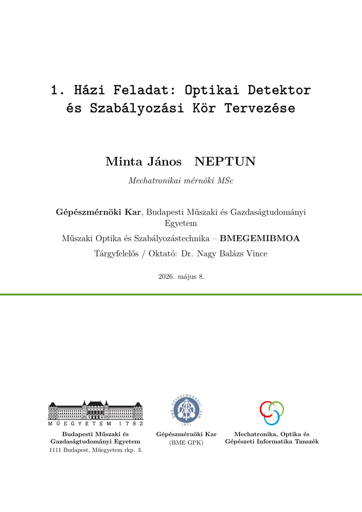
</p>

Teljes margószélességű, lapszéltől lapszélig futó `BMEgreen` vízszintes elválasztó vonal TikZ réteg-pozicionálással:

```latex
% Széltől szélig tartó elválasztó vonal (a metaadatok és a logósáv közé helyezendő)
\vspace{0.4cm}
{\par\noindent\begin{tikzpicture}[remember picture, overlay]
  \draw[BMEgreen, line width=3pt] (current page.west |- 0, 0) -- (current page.east |- 0, 0);
\end{tikzpicture}\par}
\vspace{0.4cm}
```

3 oszlopos intézményi lábléc logókkal:

```latex
\vfill
\begin{minipage}[t]{0.38\textwidth}
  \centering
  \includegraphics[height=1.5cm]{\UniversityLogoPath}\\[6pt]
  {\footnotesize \textbf{\UniversityName}\\[2pt]\UniversityAddress\par}
\end{minipage}%
\hfill
\begin{minipage}[t]{0.24\textwidth}
  \centering
  \includegraphics[height=1.8cm]{\FacultyLogoPath}\\[6pt]
  {\footnotesize \textbf{\FacultyName}\\[2pt](\FacultyShort)\par}
\end{minipage}%
\hfill
\begin{minipage}[t]{0.34\textwidth}
  \centering
  \includegraphics[height=1.4cm]{\DepartmentIconPath}\\[6pt]
  {\footnotesize \textbf{\DepartmentName}\par}
\end{minipage}
```

Futó fejléc függőlegesen középre igazított tanszéki logóval:


```latex
\pagestyle{fancy}
\fancyhf{}

% A zöld vonal és a lap felső széle között vertikálisan középre igazított logó
\fancyhead[L]{%
  \ifx\DepartmentIconPath\empty\else
    \raisebox{2.25mm}{\includegraphics[height=1.1cm]{\DepartmentIconPath}}%
  \fi
}
\fancyhead[R]{%
  \parbox[b]{15cm}{\raggedleft
    \large\textbf{\CourseName}\\[2pt]
    \normalsize\textbf{\CourseCode}\vspace{0.25cm}
  }%
}

% Teljes szélességű zöld elválasztó vonal
\renewcommand{\headrule}{%
  \nointerlineskip
  \begin{tikzpicture}[remember picture, overlay]
    \draw[BMEgreen, line width=3pt] (current page.west |- 0, 0) -- (current page.east |- 0, 0);
  \end{tikzpicture}%
}
\fancyfoot[C]{\thepage. oldal}
\fancyfoot[R]{\small\StudentName\\\NeptunCode}
```

---

### 3. Feladat és Megoldás Dobozok

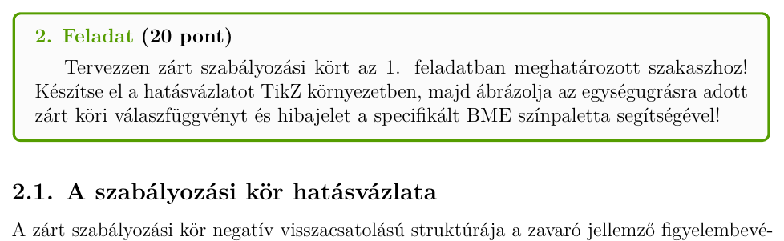

Kiemelt feladatdoboz opcionális pontszám-jelvénnyel és piros hangsúlyú megoldásblokkal:

```latex
\begin{problem}[15 pont]
Adja meg az elektromechanikai hajtás állapotegyenleteit, és számítsa ki a vágási frekvenciát a megadott paraméterek alapján!
\end{problem}

\begin{solution}
A mechanikai alrendszer Lagrange-egyenlete:
\begin{equation}
  J \ddot{\theta}(t) + b \dot{\theta}(t) + k \theta(t) = M(t)
\end{equation}
A Laplace-transzformált egyenletből az átviteli függvény:
\begin{equation}
  W(s) = \frac{\Theta(s)}{M(s)} = \frac{1}{J s^2 + b s + k}
\end{equation}
\end{solution}
```

---

### 4. Táblázatok

Mindkét szabványos sablon-táblázat (Style A és Style B) tartalmazza a sablonszintű `\tableheaderrule` makrót, amely egy `1.5pt` vastag, `BMEgreen` színű hangsúlyos elválasztó vonalat húz közvetlenül a fejléc alá, pontosan megegyezve a feladatdoboz keretvastagságával.

#### 4.1 Style A: 3 Oszlopos Megadott Paraméterek
Fehér rácsvonalak váltakozó fehér és világosszürke (`tableGray`) sorokkal, zöld fejléc alatti vonallal:

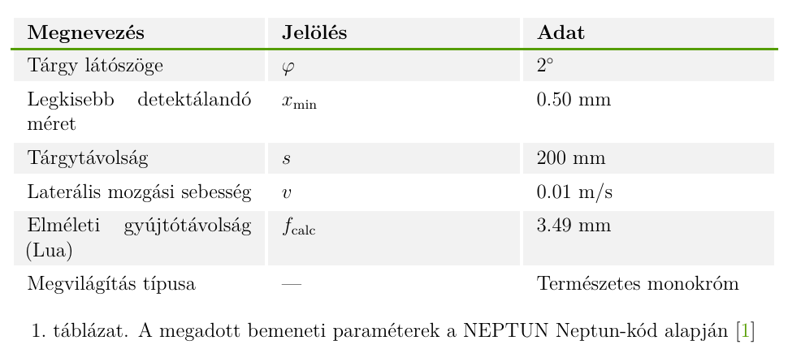

```latex
\begin{table}[ht!]
\centering
\renewcommand{\arraystretch}{1.25}
\setlength{\tabcolsep}{8pt}
\setlength{\arrayrulewidth}{2pt}
\arrayrulecolor{white}
\rowcolors{2}{white}{tableGray}
\begin{tabularx}{\textwidth}{|X|X|X|}
\hline
\rowcolor{tableGray}
\textbf{Megnevezés} & \textbf{Jelölés} & \textbf{Adat} \\
\tableheaderrule
Tárgy látószöge               & $\varphi$        & $2^\circ$ \\ \hline
Legkisebb detektálandó méret  & $x_{\min}$       & $0.50\text{ mm}$ \\ \hline
Tárgytávolság                 & $s$              & $200\text{ mm}$ \\ \hline
Laterális mozgási sebesség    & $v$              & $0.01\text{ m/s}$ \\ \hline
Tápfeszültség                 & $U_t$            & $24\text{ V DC}$ \\ \hline
\end{tabularx}
\caption{A megadott bemeneti feladatparaméterek \cite{hazi}}
\label{tab:parameterek}
\end{table}
```

#### 4.2 Style B: 2 Oszlopos Műszaki Specifikáció (Többsoros / Multi-row)
Alkatrész-adatlapokhoz megerősített `3pt` vastag fehér középső elválasztó vonallal és `1.5pt` `BMEgreen` fejléc-vonallal:

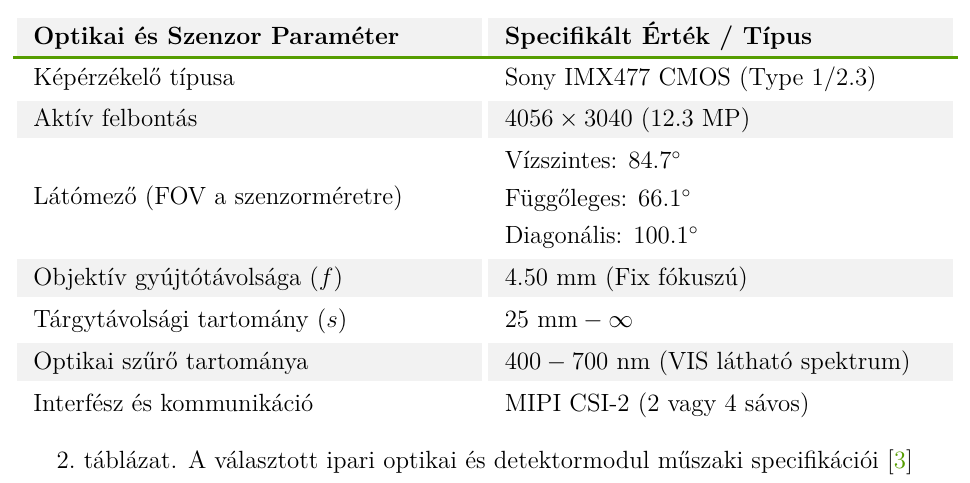

```latex
\begin{table}[ht!]
\centering
\renewcommand{\arraystretch}{1.25}
\setlength{\tabcolsep}{8pt}
\setlength{\arrayrulewidth}{2pt}
\arrayrulecolor{white}
\begin{tabularx}{\textwidth}{|X!{\color{white}\vrule width 3pt}X|}
\hline
\rowcolor{tableGray}
\textbf{Optikai és Szenzor Paraméter} & \textbf{Specifikált Érték / Típus} \\
\tableheaderrule
\rowcolor{white}
Képérzékelő típusa & Sony IMX477 CMOS (Type 1/2.3) \\ \hline
\rowcolor{tableGray}
Aktív felbontás & $4056 \times 3040\text{ (12.3 MP)}$ \\ \hline
\rowcolor{white}
 & Vízszintes: $84.7^\circ$ \\
\rowcolor{white}
 & Függőleges: $66.1^\circ$ \\
\rowcolor{white}
\multirow{-3}{\linewidth}{Látómező (FOV a szenzorméretre)} & Diagonális: $100.1^\circ$ \\ \hline
\rowcolor{tableGray}
Objektív gyújtótávolsága ($f$) & $4.50\text{ mm}$ (Fix fókuszú) \\ \hline
\rowcolor{white}
Tárgytávolsági tartomány ($s$) & $25\text{ mm} - \infty$ \\ \hline
\rowcolor{tableGray}
Optikai szűrő hullámhossza & $400 - 700\text{ nm}$ (VIS tartomány) \\ \hline
\end{tabularx}
\caption{A választott optikai modul műszaki specifikációi \cite{adatlap}}
\label{tab:muszaki_adatok}
\end{table}
```

#### 4.3 Style C: Mérési Adattáblázat Mértékegységekkel (`siunitx`)

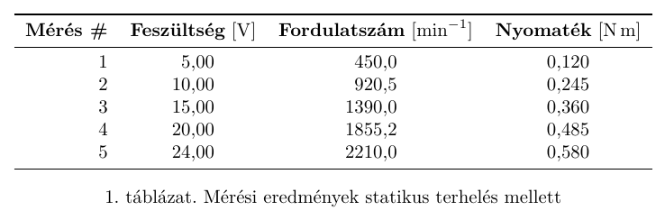

```latex
\begin{table}[ht!]
\centering
\begin{tabular}{r S[table-format=2.2] S[table-format=3.1] S[table-format=1.3]}
\toprule
\textbf{Mérés \#} & {\textbf{Feszültség} [\unit{\volt}]} & {\textbf{Fordulatszám} [\unit{\per\minute}]} & {\textbf{Nyomaték} [\unit{\newton\meter}]} \\
\midrule
1 & 5.00  & 450.0  & 0.120 \\
2 & 10.00 & 920.5  & 0.245 \\
3 & 15.00 & 1390.0 & 0.360 \\
4 & 20.00 & 1855.2 & 0.485 \\
5 & 24.00 & 2210.0 & 0.580 \\
\bottomrule
\end{tabular}
\caption{Mérési eredmények statikus terhelés mellett}
\label{tab:meres}
\end{table}
```

---

### 5. Forráskódok (MATLAB Sötét Téma)

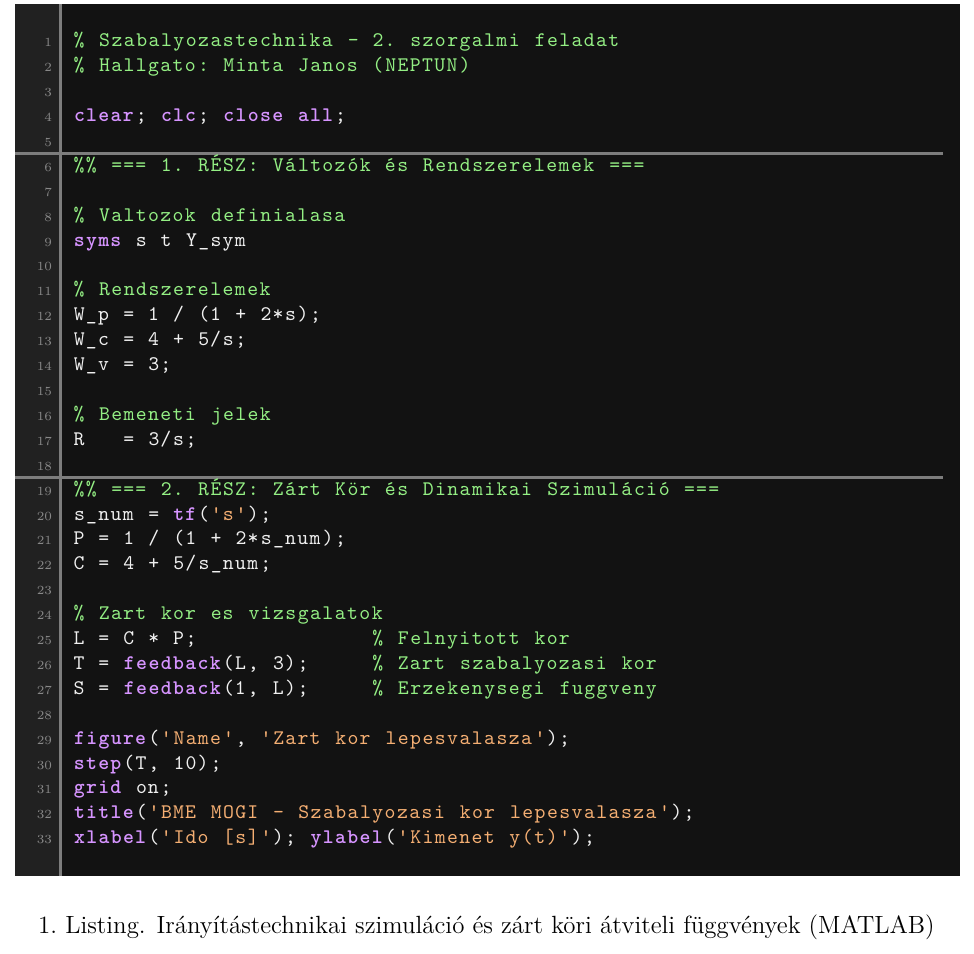

A MATLAB editor hivatalos sötét témáját hűen visszaadó kódrészlet-megjelenítés:
- **Kódszerkesztő háttér**: `rgba(18, 18, 18)` (`#121212`)
- **Sorszám-sáv háttér (a sorok számai mögött)**: `rgba(33, 33, 33)` (`#212121`)
- **Függőleges elválasztó vonal**: `rgba(125, 125, 125)` (`#7D7D7D`), 1.5pt vastag vonal a sorszámok és a forráskód szövege között
- **Szakasz-elválasztó vonalak (`\matlabrule`)**: `rgba(125, 125, 125)` (`#7D7D7D`), 1.5pt vastag vonal a `%%` szakaszelválasztók felett
- **Szintaxiskiemelés**: Világoszöld kommentek (`#94EF84`), lila kulcsszavak (`#D694FF`), barackszínű sztringek (`#F5AF73`) és diszkrét szürke sorszámok (`#888888`)

```latex
\begin{matlabbox}
\begin{lstlisting}[style=matlabdark]
% Szabalyozastechnika - 2. szorgalmi feladat
% Hallgato: Minta Janos (NEPTUN)

clear; clc; close all;

(*@\matlabrule@*)%% === 1. RÉSZ: Rendszerelemek definíciója ===

% Szimbolikus valtozok
syms s t Y_sym

% Szakasz es szabalyozo
W_p = 1 / (1 + 2*s);
W_c = 4 + 5/s;
W_v = 3;

% Bemeneti alapjel
R   = 3/s;

(*@\matlabrule@*)%% === 2. RÉSZ: Dinamikai szimuláció ===
s_num = tf('s');
P = 1 / (1 + 2*s_num);
C = 4 + 5/s_num;

L = C * P;              % Felnyitott kor
T = feedback(L, W_v);   % Zart szabalyozasi kor

figure('Name', 'Lepesvalasz');
step(T, 10);
grid on;
title('BME MOGI - Zart kor lepesvalasza');
xlabel('Ido [s]'); ylabel('Kimenet y(t)');
\end{lstlisting}
\end{matlabbox}
\captionof{lstlisting}{Irányítástechnikai szimuláció és zárt köri átviteli függvények (MATLAB)}
```

---

### 6. Irányítástechnikai Hatásvázlatok és Blokkvázlatok (TikZ)

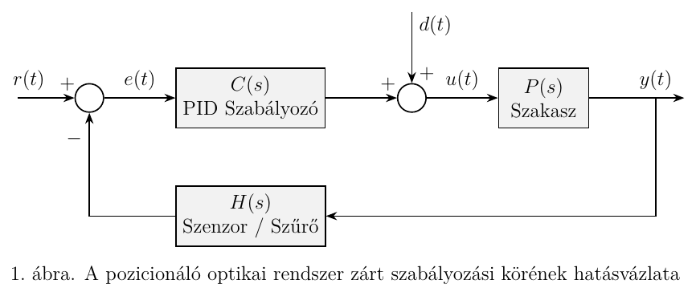

Negatív visszacsatolású szabályozási kör alapjellel, összegző taggal, szabályozóval, szakasszal, visszacsatoló érzékelővel és zavaró jellemzővel:

```latex
\begin{figure}[ht!]
\centering
\begin{tikzpicture}[auto, node distance=2.2cm]
  % Csomópontok
  \node [input, name=input] {};
  \node [sum, right=1.2cm of input] (sum1) {};
  \node [block, right=1.5cm of sum1] (controller) {$C(s)$\\PID Szabályozó};
  \node [sum, right=1.5cm of controller] (sum2) {};
  \node [block, right=1.5cm of sum2] (plant) {$P(s)$\\Szakasz};
  \node [output, right=2.0cm of plant] (output) {};
  \node [input, above=1.5cm of sum2] (disturbance) {};
  \node [block, below=1.2cm of controller] (sensor) {$H(s)$\\Visszacsatolás};

  % Jelvonalak
  \draw [->, thick] (input) -- node [pos=0.2] {$r(t)$} node [very near end] {$+$} (sum1);
  \draw [->, thick] (sum1) -- node {$e(t)$} (controller);
  \draw [->, thick] (controller) -- node [very near end] {$+$} (sum2);
  \draw [->, thick] (disturbance) -- node [pos=0.2] {$d(t)$} node [very near end] {$+$} (sum2);
  \draw [->, thick] (sum2) -- node {$u(t)$} (plant);
  \draw [->, thick] (plant) -- node [name=y, pos=0.7] {$y(t)$} (output);
  
  % Visszacsatoló ág
  \draw [->, thick] (y) |- (sensor);
  \draw [->, thick] (sensor) -| node [very near end] {$-$} (sum1);
\end{tikzpicture}
\caption{A zárt szabályozási kör hatásvázlata}
\label{fig:szabalyozasi_kor}
\end{figure}
```

---

### 7. Szimulációs Grafikonok és Lépésválaszok (`pgfplots`)

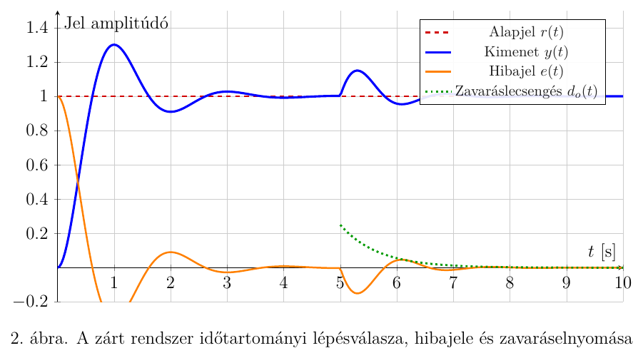

Hivatalos BME színekkel megrajzolt időtartományi dinamikai válaszfüggvények (Alapjel: `BMEred`, Kimenet: `blue`, Hibajel: `orange`, Zavaráslecsengés: `green!60!black`):

```latex
\begin{figure}[ht!]
\centering
\begin{tikzpicture}
\begin{axis}[
    width=15cm,
    height=8.5cm,
    grid=both,
    grid style={line width=.1pt, draw=gray!20},
    major grid style={line width=.2pt, draw=gray!40},
    axis lines=middle,
    xlabel={$t\ [\text{s}]$},
    ylabel={Jel amplitúdó},
    xmin=0, xmax=10,
    ymin=-0.2, ymax=1.5,
    legend pos=north east,
    legend style={font=\footnotesize, fill=white, fill opacity=0.9},
    samples=300
]

% Referencia bemenet r(t)
\addplot[domain=0:10, color=BMEred, dashed, line width=1.2pt] {1.0};
\addlegendentry{Alapjel $r(t)$}

% Rendszer kimenete y(t)
\addplot[domain=0:10, color=blue, line width=1.5pt] {
  1.0 - exp(-1.2*x)*(cos(deg(3.14*x)) + 0.38*sin(deg(3.14*x))) + 
  (x > 5 ? 0.25*exp(-1.5*(x-5))*sin(deg(4.0*(x-5))) : 0)
};
\addlegendentry{Kimenet $y(t)$}

% Hibajel e(t)
\addplot[domain=0:10, color=orange, line width=1.2pt] {
  exp(-1.2*x)*(cos(deg(3.14*x)) + 0.38*sin(deg(3.14*x))) -
  (x > 5 ? 0.25*exp(-1.5*(x-5))*sin(deg(4.0*(x-5))) : 0)
};
\addlegendentry{Hibajel $e(t)$}

% Zavarás lecsengése d(t)
\addplot[domain=5:10, color=green!60!black, dotted, line width=1.4pt] {
  0.25*exp(-1.5*(x-5))
};
\addlegendentry{Zavaráslecsengés $d_o(t)$}

\end{axis}
\end{tikzpicture}
\caption{A szabályozási kör időtartományi válaszfüggvényei}
\label{fig:lepesvalasz_plot}
\end{figure}
```

---

### 8. Matematikai Egyenletek és Állapottér Modellek

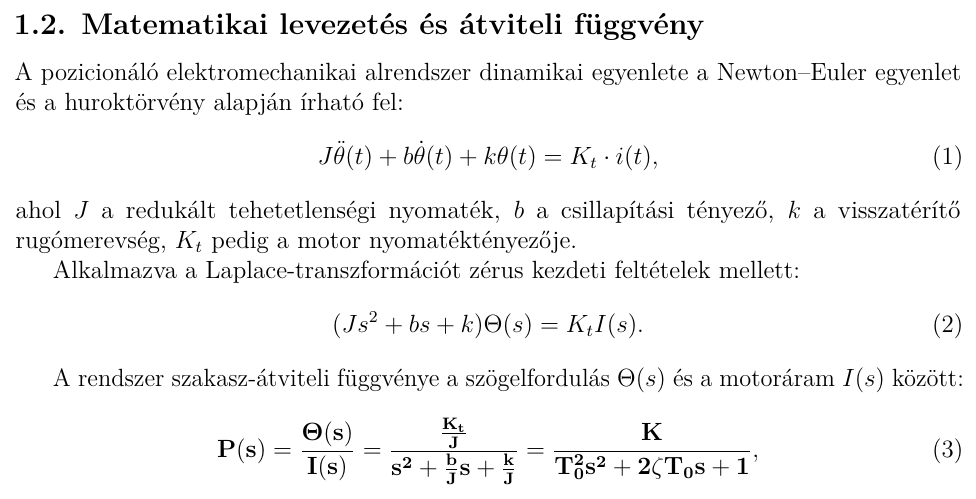

Számozott analitikus levezetések, kiemelt eredmények és mátrixos állapottér-ábrázolás:

```latex
% Számozott analitikus levezetés
\begin{equation}
  \mathbf{P(s) = \frac{Y(s)}{U(s)} = \frac{K}{T_0^2 s^2 + 2\zeta T_0 s + 1}}
  \label{eq:atviteli_fuggveny}
\end{equation}

% Állapottér-modell mátrixos alakban
\begin{align}
  \begin{bmatrix} \dot{x}_1 \\ \dot{x}_2 \end{bmatrix} &=
  \begin{bmatrix} 0 & 1 \\ -\frac{k}{J} & -\frac{b}{J} \end{bmatrix}
  \begin{bmatrix} x_1 \\ x_2 \end{bmatrix} +
  \begin{bmatrix} 0 \\ \frac{K_t}{J} \end{bmatrix} u(t) \label{eq:allapot_matrix} \\[6pt]
  y(t) &= \begin{bmatrix} 1 & 0 \end{bmatrix} \begin{bmatrix} x_1 \\ x_2 \end{bmatrix}
\end{align}
```

---

### 9. Beágyazott Lua Számítási Híd

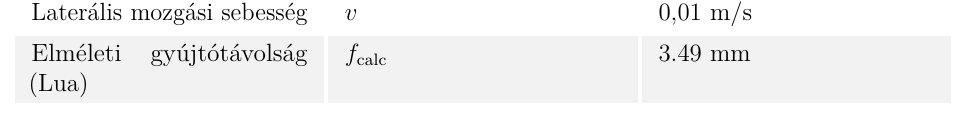

Pontos numerikus értékek előzetes kiszámítása beágyazott Lua környezetben és közvetlen kiírása TeX makrókba:

```latex
\begin{luacode*}
function calculate_design_params()
    local s_dist = 200.0   -- mm
    local phi_deg = 2.0    -- fok
    local phi_rad = phi_deg * math.pi / 180.0
    local f_target = s_dist * math.tan(phi_rad / 2.0)
    tex.print(string.format("\\def\\calcFocLength{%.2f}", f_target))
end
\end{luacode*}
\directlua{calculate_design_params()}

% A számított érték bárhol közvetlenül felhasználható folyószövegben vagy egyenletben:
A számított elméleti gyújtótávolság: $f = \calcFocLength\text{ mm}$.
```

---

### 10. Külső PDF és CAD Mellékletek

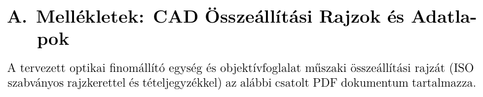

Többoldalas CAD összeállítási rajzok, adatlapok vagy kapcsolási rajzok zökkenőmentes csatolása a jegyzőkönyv végéhez az egységes futó fejléc megtartásával:

```latex
\newpage
\appendix
\section{Mellékletek: Gépészeti CAD Összeállítási Rajzok}
\label{sec:melleklet}

A tervezett modul gyártási rajzát az alábbi csatolt PDF tartalmazza:

\includepdf[
  pages=-,
  scale=0.92,
  pagecommand={\thispagestyle{fancy}}
  landscape=true
]{appendices/cad_assembly.pdf}
```
